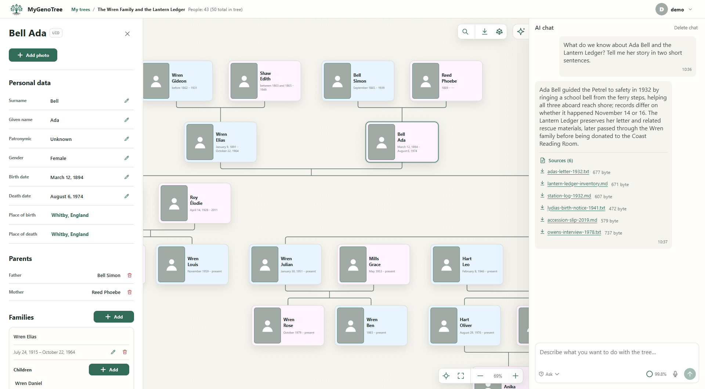

# MyGenoTree

MyGenoTree is a private workspace for exploring your family history. Follow relationships across generations, open a person's card to see their life events and family, and ask the AI assistant questions about the people and documents in your tree.



## Installation

From the project root, copy the environment template.

```sh
cp .env.dist .env
```

Give each of the five empty settings in `.env` its own random 64-character hex string. Then install and start the project with Docker Compose v2.

```sh
docker compose run --rm backend composer install --no-interaction
docker compose run --rm frontend npm ci
docker compose run --rm backend php bin/console doctrine:migrations:migrate --no-interaction
docker compose up -d
```
