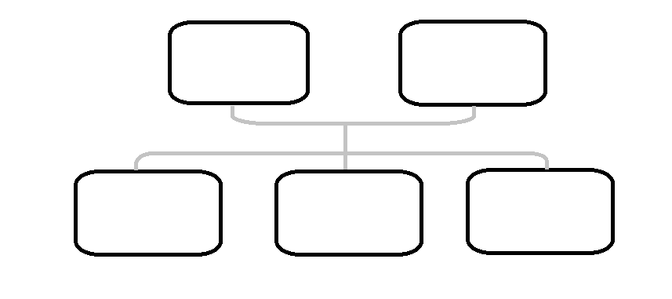
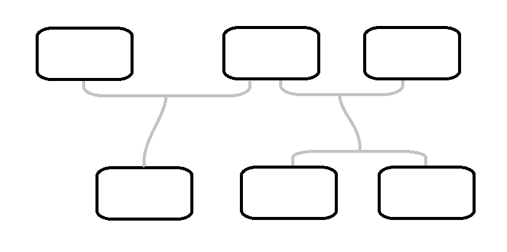
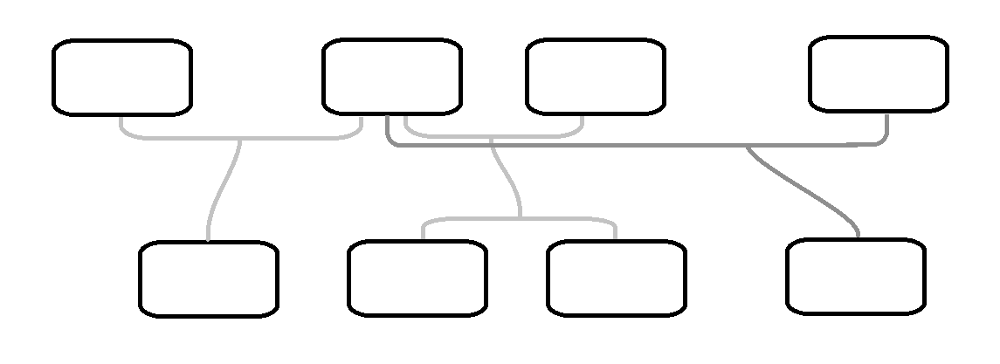

# Требования к MVP MyGenoTree

## 1. Языки

MVP поддерживает:

- английский;
- русский.

Язык по умолчанию — английский.

Локаль не входит в URL. Набор маршрутов и доступность страниц не зависят от локали.

Для неавторизованного пользователя:

1. при отсутствии сохранённого выбора язык определяется по `Accept-Language`;
2. если поддерживаемого языка нет, выбирается английский;
3. ручной выбор сохраняется в cookie на один год;
4. пока cookie существует, `Accept-Language` повторно не применяется.

Для авторизованного пользователя используется язык профиля. После успешного входа он имеет приоритет над языком, выбранным до входа.

Любой системный текст локализуется. Не переводятся:

- название MyGenoTree;
- логины;
- названия деревьев;
- ФИО;
- названия и описания пользовательских событий;
- другой введённый пользователем текст.

В выборе языка English сопровождается флагом США, русский — флагом России.

## 2. Общая шапка

Шапка:

- имеет высоту не более `50px`;
- присутствует на всех страницах;
- содержит логотип и название MyGenoTree;
- не перекрывает содержимое и область дерева.

Для гостя шапка содержит:

- кнопку входа/регистрации;
- выбор языка.

Для авторизованного пользователя шапка содержит кнопку профиля с аватаром и dropdown:

- «Профиль»;
- «Мои деревья»;
- «Выйти».

Язык авторизованного пользователя изменяется только в профиле.

Если аватар отсутствует, показывается нейтральный серый плейсхолдер.

## 3. Главная страница

Главная страница содержит:

- общую шапку;
- блок описания продукта с временным текстом-заглушкой;
- текущее число зарегистрированных аккаунтов;
- текущее число неудалённых деревьев.

Счётчики могут кэшироваться и обновляться с небольшой задержкой. Они не являются источником квот или бизнес-проверок.

## 4. Регистрация и вход

### 4.1 Представления

При явном клике по кнопке в шапке форма открывается в модальном окне по центру текущей страницы.

Если гость пытается открыть защищённый маршрут, показывается отдельная страница входа. После успешной авторизации пользователь возвращается на исходный маршрут.

Модальная форма и отдельная страница используют одинаковые поля, валидацию и API.

### 4.2 Переключение формы

Начальный режим — вход.

Форма входа содержит:

- поле «Логин или email»;
- пароль;
- кнопку «Войти»;
- ссылку-кнопку «Или создать аккаунт».

Режим регистрации содержит:

- логин;
- email;
- пароль;
- подтверждение пароля;
- кнопку «Зарегистрироваться»;
- ссылку-кнопку «У меня уже есть аккаунт».

Переключение режима не закрывает модальное окно.

### 4.3 Регистрация

Правила логина, email и пароля определены в [domain.md](domain.md#2-пользователь).

Подтверждение пароля проверяется frontend до отправки. Backend всегда самостоятельно проверяет пароль по доменным правилам.

После успешной регистрации:

- создаётся аккаунт;
- язык профиля устанавливается в текущий выбранный язык;
- создаётся первая токенная сессия;
- пользователь считается авторизованным;
- при обычной регистрации выполняется переход на главную;
- при регистрации со страницы защищённого маршрута выполняется возврат на этот маршрут.

Подтверждение email в MVP не требуется.

### 4.4 Вход

Вход возможен:

- по регистрозависимому логину;
- по регистронезависимому нормализованному email.

Несуществующий идентификатор и неверный пароль возвращают одну общую ошибку. Интерфейс не сообщает, существует ли аккаунт.

### 4.5 Выход

Выход:

- отзывает текущую серверную сессию;
- удаляет refresh-cookie;
- удаляет access-токен из памяти frontend;
- немедленно закрывает доступ через ранее выданный access-токен;
- не завершает сессии других устройств.

## 5. Страница «Мои деревья»

Страница доступна только авторизованному пользователю.

Деревья сортируются по дате последнего изменения, новые сверху.

Плитка дерева содержит:

- название;
- число персон;
- локализованную дату последнего изменения;
- действие «Открыть»;
- действие «Переименовать»;
- действие «Удалить».

Страница содержит кнопку создания дерева.

### 5.1 Создание

Кнопка открывает модальное окно:

- поле названия;
- «Создать»;
- «Отмена».

После успешного создания открывается пустой редактор дерева.

### 5.2 Переименование

Переименование выполняется в модальном окне с явными действиями «Сохранить» и «Отмена».

### 5.3 Удаление

Перед удалением показывается подтверждение с названием дерева и предупреждением о необратимости. Последствия определены в [domain.md](domain.md#10-удаление).

## 6. Редактор дерева

Редактор поддерживается только на desktop. Мобильная и планшетная адаптация интерактивного графа не входит в MVP.

Вся страница под шапкой занята областью дерева.

Элементы:

- интерактивная область карточек и связей;
- боковая панель выбранной персоны;
- кнопки `+` и `-` и текущее значение масштаба в правом нижнем углу.

Управление мышью:

- drag по свободной области панорамирует дерево;
- колесо мыши изменяет масштаб;
- кнопки `+` и `-` изменяют масштаб предсказуемым шагом.

Клавиатурное управление графом, поиск, minimap и ручное перемещение карточек не входят в MVP.

### 6.1 Открытие дерева

При открытии:

- загружается компактный snapshot;
- обычное дерево строится относительно сохранённой опоры;
- у старого непустого дерева опорой становится первая персона по времени создания, затем UUID;
- область центрируется на одиночной опорной карточке или середине семейного блока опорного брака;
- начальный масштаб равен 100%;
- сохранённый ранее viewport браузера не восстанавливается.

Если дерево пустое, по центру показывается кнопка «Создать персону».

Первая персона становится опорной. После её создания новые персоны добавляются через связи.

### 6.2 Состав и детерминированная раскладка

Опорой является одна персона либо супружеская пара с хотя бы одним периодом брака. Для пары видимый состав независимо вычисляется относительно каждого супруга по исходному полному snapshot, после чего два множества объединяются без повторного запуска правил.

Один запуск правил добавляет:

- саму опорную персону;
- всех кровных предков и потомков рекурсивно;
- обоих известных родителей каждого кровного потомка;
- братьев и сестёр каждого родителя, их детей и обоих родителей этих детей;
- братьев, сестёр и всех супругов опорной персоны;
- родителей и братьев/сестёр каждого супруга;
- детей супругов от других партнёров и обоих родителей этих детей;
- детей братьев/сестёр и обоих родителей этих детей.

Сиблингом считается персона хотя бы с одним общим известным родителем. Учитываются все периоды брака, включая расторгнутые. Локальные расширения применяются один раз; рекурсивными являются только обходы кровных предков и потомков. Показываются все связи, оба конца которых входят в итоговое множество.

Frontend использует сохранённую раскладку с совместимой версией алгоритма, если она присутствует в snapshot. Иначе он вычисляет координаты локально. Расчёт длительностью не менее 2 секунд асинхронно сохраняется как производный кэш и не блокирует первый рендер.

На дерево хранится не более 10 раскладок: ровно одна для каждой опорной персоны или канонической пары супругов. При добавлении одиннадцатой удаляется раскладка с самым старым временем последнего использования, а не создания. Лимит задаётся одной документированной backend-константой. Неструктурная мутация с прежней `layoutRevision` не запускает повторный расчёт и не сбрасывает камеру. Структурная мутация удаляет только раскладки, видимая проекция которых изменилась.

В БД и API производной раскладки входят только версия алгоритма и отображение `personId -> [x, y]`. Скобки и рёбра не сохраняются. Производный кэш можно полностью удалить без потери данных дерева.

Раскладка должна:

- располагать поколения сверху вниз;
- не допускать наложения карточек;
- одинаково обрабатывать одинаковый граф независимо от порядка массивов и предыдущих рендеров;
- использовать роли родителей и UUID для стабильного разрешения симметрии;
- визуально отличать браки от совместного родительства без брака;
- по возможности уменьшать пересечения линий;
- помещать центр одиночной опоры или середину семейного блока опорной пары в начало координат.

Контекстное меню карточки позволяет назначить саму персону или уникальный брак с каждым супругом опорой. Контекстное меню брачной скобки позволяет назначить соответствующий брак; у скобки совместного родительства без брака такого действия нет.

Одиночная опора постоянно отмечена контрастным halo и значком. У опорного брака отмечаются обе карточки и брачная скобка; выделение выбранной для редактирования персоны остаётся отдельным состоянием. После смены опоры камера центрируется на ней, а панель редактирования закрывается только если выбранная персона стала невидимой.

Силовая карта не ограничивает состав персон, использует полный snapshot и сохраняет только собственное состояние позиций и viewport.

## 7. Создание и карточка персоны

### 7.1 Создание

Создание открывает диалог с полями:

- фамилия при рождении;
- имя;
- отчество;
- пол;
- дата рождения;
- дата смерти.

Для каждого поля доступно специальное значение «неизвестно».

Дата смерти:

- по умолчанию отсутствует, что означает «жива»;
- появляется после включения «Умер»;
- после этого может быть известной или неизвестной.

Диалог содержит «Сохранить» и «Отмена». Сущность не создаётся частично.

Если персона создаётся через связь, диалог дополнительно показывает:

- выбранную существующую персону;
- тип связи;
- роль новой персоны;
- второго родителя ребёнка либо вариант «неизвестен», если применимо.

Пользователь может вместо создания выбрать существующую персону текущего дерева.

### 7.2 Карточка

Карточка содержит:

- основную производную фотографии или плейсхолдер;
- ФИО с фамилией при рождении;
- период жизни.

Карточка имеет фиксированный размер.

Слишком длинное ФИО занимает ограниченное число строк и заканчивается ellipsis. Полное ФИО доступно в tooltip и боковой панели.

Неизвестные части ФИО не заменяются пустыми декоративными пробелами. Если неизвестны все части, показывается «Неизвестная персона».

Если дата рождения или смерти неизвестна, в соответствующем месте периода жизни показывается прочерк. Для живой персоны вместо даты смерти показывается локализованное «по настоящее время».

Клик по карточке:

- выделяет её;
- открывает боковую панель;
- показывает допустимые действия добавления родственников.

### 7.3 Плейсхолдеры родственников

Для выбранной персоны могут показываться действия:

- добавить отца, если отец отсутствует;
- добавить мать, если мать отсутствует;
- добавить супруга или супругу;
- добавить ребёнка.

При добавлении ребёнка пользователь:

- выбирает одного или двух известных родителей;
- при нескольких супругах явно выбирает второго родителя;
- может указать, что второй родитель неизвестен;
- может выбрать второго родителя, с которым брака нет.

Существование нескольких супругов не скрывает действие добавления ребёнка.

## 8. Отображение связей

Область дерева отображает:

- браки;
- совместное родительство без брака;
- родительские связи.

### 8.1 Брак

Брак обозначается сплошной скобкой под карточками супругов.

Несколько периодов брака одной пары не создают несколько параллельных линий между одними карточками. Подробности периодов видны в панели.

### 8.2 Родители без брака

Два родителя общего ребёнка, не имеющие периода брака, соединяются отдельной пунктирной парной скобкой.

Такая линия не должна визуально восприниматься как брак.

### 8.3 Дети

Общие дети соединяются скобкой над их карточками. Она соединяется с линией пары родителей.

Если известен один родитель, линия детей выходит непосредственно от его карточки без создания фиктивного второго родителя.

Базовая схема:

Пример нескольких супругов:

Схемы задают семантику линий, а не точные пиксельные координаты.

## 9. Боковая панель персоны

Панель содержит:

- личные данные;
- родителей;
- семьи;
- детей вне брака;
- события;
- действия удаления, если оно допустимо.

Каждое простое поле:

- по умолчанию показывается read-only;
- имеет рядом кнопку-карандаш;
- редактируется отдельно;
- после blur или Enter валидируется и автосохраняется;
- для многострочного описания сохраняется после blur либо короткой паузы.

При ошибке значение остаётся в режиме редактирования и рядом показывается локализованная ошибка.

### 9.1 Личные данные

Показываются:

- фамилия при рождении;
- имя;
- отчество;
- пол;
- дата рождения;
- дата смерти;
- основная фотография.

Изменение поля, которое сделает существующую связь некорректной, отклоняется с объяснением.

### 9.2 Родители

Показываются отец и мать либо действия их добавления. Связь можно удалить только при выполнении правил связности.

### 9.3 Семьи

Один блок соответствует одному супругу или супруге и содержит:

- партнёра;
- список периодов брака;
- дату заключения и расторжения каждого периода;
- общих детей;
- действие добавления ребёнка;
- действия изменения и удаления периода брака.

Повторный брак не дублирует общий список детей.

### 9.4 Дети вне брака

В отдельном списке показываются дети, для которых:

- известен только выбранный родитель; либо
- второй родитель известен, но между родителями нет брака.

Отдельный семейный блок для второго родителя не создаётся.

## 10. События

События отображаются вертикальным timeline.

Автоматические события:

- рождение;
- смерть;
- вступление в брак;
- смена фамилии при браке;
- расторжение брака;
- рождение ребёнка.

Ручные события:

- смена фамилии;
- пользовательское событие.

Автоматическое событие показывает источник и не имеет прямых действий редактирования/удаления.

Для ручной смены фамилии обязательна новая фамилия.

Для пользовательского события:

- название обязательно;
- описание необязательно;
- в свёрнутом состоянии показывается название;
- по клику описание разворачивается;
- описание отображается как экранированный plain text с переносами строк.

Сортировка и ручной порядок описаны в [dates.md](dates.md#5-сортировка-событий).

## 11. Изображения

### 11.1 Общие ограничения

- JPEG, PNG или WebP;
- не более 10 МБ;
- не более 20 мегапикселей после декодирования;
- SVG и анимированные изображения запрещены;
- фактический формат проверяется декодированием;
- метаданные удаляются;
- доступ только владельцу;
- хранение через Flysystem.

### 11.2 Аватар

Редактор позволяет выбрать квадратную область произвольного размера.

Сохраняется только обработанный квадратный crop. Исходный файл аватара после успешной обработки не сохраняется.

Аватар везде показывается круглым.

Пользователь может заменить или удалить аватар.

### 11.3 Фотография персоны

Для персоны сохраняются:

- обработанная полная фотография для отдельного просмотра;
- портретный crop с соотношением ширины к высоте `3:4`;
- производная миниатюра для карточки.

Пользователь может:

- загрузить фотографию;
- выбрать crop;
- открыть полную фотографию;
- заменить фотографию;
- удалить фотографию.

Фотография реализуется через медиа-вложение, чтобы в будущем добавить галерею.

## 12. Конкурентное редактирование

Автосохранение каждого поля и любая структурная операция передают актуальный ETag дерева.

При конфликте:

- сохранение прекращается;
- локальное неподтверждённое значение остаётся видимым;
- показывается сообщение об изменении дерева в другой сессии;
- пользователь может загрузить актуальное состояние;
- автоматического merge, повторной отправки и истории версий нет.

## 13. Подтверждения и необратимость

Подтверждение требуется перед:

- удалением дерева;
- удалением персоны;
- удалением родительской связи;
- удалением периода брака;
- удалением ручного события;
- удалением аватара или фотографии.

Если операция запрещена доменными правилами, подтверждение не должно создавать ложного впечатления, что её можно выполнить.

## 14. Явно отложенные пользовательские функции

В MVP отсутствуют:

- ручное перемещение карточек;
- галерея фотографий;
- фотографии событий;
- поиск по дереву;
- импорт и экспорт;
- отчёты, графики и постеры;
- слияние деревьев;
- лимиты деревьев и персон;
- подтверждение email;
- светлая/тёмная тема;
- undo и история версий;
- управление активными сессиями;
- мобильный редактор;
- совместная работа и публикация.

Архитектурные требования для части этих функций приведены в [future.md](future.md).
