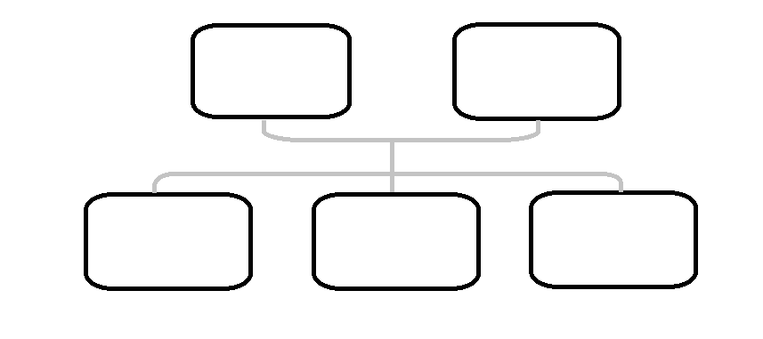
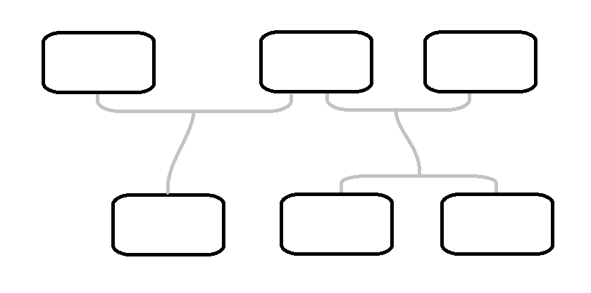
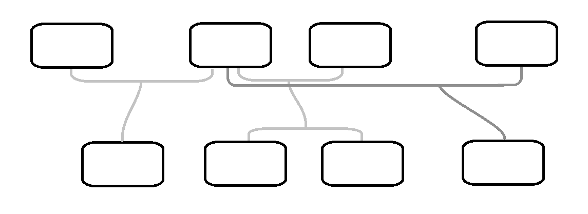

# Требования к MVP MyGenoTree

## Языки
Сайт должен быть доступен на разных языках.
На этапе MVP доступно два языка:
- английский,
- русский.

Язык по умолчанию - английский.

При открытии страницы система должна пытаться определить язык пользователя по заголовкам, отправляемых браузером.
Если основного языка пользователя нет в списке доступных на сайте языков, то выбирается язык по умолчанию.

Если пользователь вручную сменил язык - система не должна пытаться угадывать его.
После ручной смены языка система должна переходить в зону этого языка, например через добавление языка в URL.

Любой текст, появляющийся на сайте, кроме текста, введенного самим пользователем, должен отображаться на выбранном языке.
Исключение - название самого сайта, оно одинаково на всех языках.

## Главная страница
На главной странице должны располагаться следующие элементы:
- шапка (лого, название, кнопка профиля или кнопка авторизации/регистрации, кнопка смены языка),
- блок с описанием сайта (заглушка, текст будет позже),
- блок счетчиков: число зарегистрированных пользователей, число созданных генеалогических деревьев.

### Шапка
Шапка должна быть невысокой (не более 50x) и повторяться на всех страницах сайта.

Кнопка профиля должна содержать аватар пользователя и dropdown меню со следующими элементами:
- профиль (ссылка на страницу настроек профиля),
- "Мои деревья" (ссылка на страницу со списком генеалогических деревьев пользователя)
- выход (кнопка logout).

Если у пользователя нет загруженного аватара - отображать серую иконку пустого аватара.

Выбор языка - это селект со всеми доступными на сайте языками.
В селекте рядом с языком должен отображаться флаг соответствующей страны.

Кнопка смены языка должна быть доступна только неавторизованным пользователям.
Для авторизованного пользователя смена языка осуществляется из настроек профиля.

## Регистрация и авторизация

### Форма
Форма регистрации/авторизации должна быть совмещенной.
Сначала форма открывается как форма авторизации с соответствующими полями,
кнопкой "Войти" и кнопкой-ссылкой "или создать аккаунт", которая должна переключить форму на форму регистрации.
На форму регистрации отображаются поля для регистрации, кнопка "Зарегистрироваться" и кнопка-ссылка "У меня уже есть аккаунт",
которая возвращает форму в режим авторизации.

Форма должна быть в модальном окне в центре страницы.

### Регистрация
Пользователь может зарегистрироваться.
При регистрации указывается минимальный набор данных:
- логин (только латинские буквы, цифры, символ `_`, уникальный),
- пароль (с подтверждением),
- email (должна быть минимальная проверка валидности и проверка на уникальность).

Требования к паролю:
- минимальная длина 8 символов,
- не содержит пробельных символов,
- содержит символы минимум из трех категорий из этого списка:
  - строчная латинская буква,
  - заглавная латинская буква,
  - цифра,
  - спецсимвол.

После регистрации пользователь сразу должен быть авторизован и направлен на главную страницу.

### Авторизация
Авторизация возможна по логину или по email.

При вводе некорректной пары логин/пароль (или mail/пароль) нужно показывать общую ошибку о некорректных данных.
Несуществующий логин и неверный пароль должны показывать одну и ту же ошибку.

## Возможности авторизованного пользователя
Авторизованный пользователь имеет возможность создавать и просматривать свои генеалогические деревья (далее просто деревья).
Страница "Мои деревья" содержит список (плитки) всех деревьев этого пользователя и кнопку создания нового дерева.

## Настройки профиля
Страница настроек профиля должна содержать:
- загрузку аватара,
- выбор языка.

Загрузка аватара это кнопка выбора файла изображения с простым редактором.
Редактор позволяет выбрать квадратную область любого размера на изображении.
На сервер должна сохраняться только выбранная область. При этом сам аватар везде отображается круглым.

Выбор языка - это селект со всеми доступными на сайте языками.
В селекте рядом с языком должен отображаться флаг соответствующей страны.

## Создание генеалогического дерева
Пользователь может создать несколько независимых (непересекающихся) деревьев.

При создании нового дерева (при нажатии кнопки создания) должно открыться модальное окно с вводом названия дерева и кнопкой "Создать".
Название дерева не может быть пустым.
У одного пользователя названия деревьев не могут повторяться (но могут быть деревья с одинаковым названием у разных пользователей).

## Работа с генеалогическим деревом
Вся страница (кроме шапки) должна быть занята интерактивной областью просмотра и редактирования дерева.
Расположение элементов:
- Слева располагается панель ввода и отображения данных персоны. Панель должна появляться только когда пользователь хочет редактировать персону.
- В правом нижнем углу должна быть шкала масштаба и кнопки "+" и "-" для изменения масштаба.

Если дерево пустое, то в центре области должна быть кнопка "Создать персону".
Так же персону можно добавить в дерево через создание связи с уже существующей персоной (см. раздел "Карточка персоны").

## Создание персоны
При создании персоны появляется диалоговое окно с вводом данных персоны:
- Фамилия
- Имя
- Отчество
- Пол
- Дата рождения
- Дата смерти
В каждое поле должна быть возможность ввести значение "неизвестно":
это не пустое значение, а признак того, что значение этого поля неизвестно.

Поле "Дата смерти" по умолчанию скрыто и появляется при включении чекбокса "Умер".

Дата рождения и дата смерти могут быть неполными: смотри [dates.md](dates.md).

Если персона добавляется через создание связи, то дополнительно должен быть блок с указанием родственной свези с другой персоной: ФИО и тип родства.

Диалоговое окно содержит кнопки "Сохранить" и "Отмена".

## Карточка персоны
Карточка персоны это то, как персона отображается в дереве.

Для каждой персоны указывается ФИО, фото и время жизни.
Если персона жива, то вместо даты смерти отображается "по настоящий день".
Если дата рождения или дата смерти неизвестны, то на этих местах ставится прочерк.

Клик по карточке персоны открывает боковую панель просмотра и редактирования данных персоны.
При этом в дереве для этой персоны добавляются карточки-плейсхолдеры:
- отец (появляется сверху слева над персоной, если у персоны еще не создан отец),
- мать (появляется сверху справа над персоной, если у персоны еще не создана мать),
- супруг/супруга (появляется сбоку, если у персоны нет ни одного супруга/супруги),
- ребенок (появляется если у персоны есть ровно один супруг/супруга).

## Отображение связей
Область дерева должна отображать следующие связи:
- супруг-супруга,
- родитель-ребенок.

Супружеская связь обозначается скобкой, соединяющей супругой, и находится под карточками персон.
Связь родитель-ребенок обозначается скобкой, соединяющей всех братьев и сестер, имеющих общих родителей.
Эта скобка находится над карточками персон и соединяется короткой линией со скобкой супругов:

При этом если у одной персоны есть несколько супругов, то их нужно стараться располагать так,
чтобы было как можно меньше пересечений линий.
Пример для двух супругов: 
Пример для трех супругов: 

## Панель редактирования персоны
Панель персоны содержит подробную информацию о выбранной персоне.
На панели должны располагаться блоки:
- личные данные,
- родители,
- семьи,
- события.

### Личные данные
Бло содержит:
- ФИО,
- дата рождения,
- дата смерти,
- фото.

### Родители
Блок содержит родителей или кнопки создания родителей, если их нет.

### Семьи
Блок содержит супругов и детей.

Каждый супруг добавляет отдельный блок "Семья" с полями:
- супруг/супруга,
- дата заключения брака,
- дата расторжения брака (с возможностью указать "по настоящее время"),
- дети (список совместных детей с этим супругом и кнопка добавления ребенка).

Примечание: генеалогическое дерево отражает только кровное родство,
поэтому проект ни в каком виде не предусматривает указание усыновленных детей.

### События
События - это важные моменты в жизни человека.
События должны отображаться как вертикальный таймлайн: сверху рождение, снизу смерть. 

Система должна создавать следующие события автоматически:
- рождение,
- смерть,
- вступление в брак,
- смена фамилии (дополнительное событие при вступлении в брак, если при добавлении супруга было указано, что персона меняет фамилию),
- расторжение брака,
- рождение ребенка.

Следующие события можно создавать вручную:
- смена фамилии,
- пользовательское событие.

Для каждого события нужно указывать дату. Смотри [dates.md](dates.md).

При создании события "Смена фамилии" должно появляться дополнительное поле для указания новой фамилии.

При создании пользовательского события появляются дополнительные поля:
- название события,
- описание события.
Для такого события на таймлайне отображается только название.
При клике на событие в таймлайне разворачивается описание события.